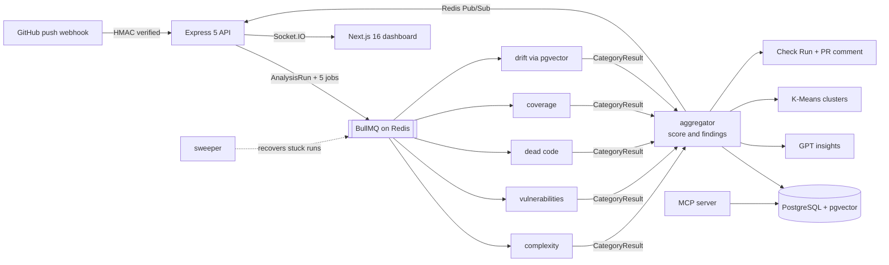

# CodePulse

**A GitHub App that scores your repo's health from 0 to 100 within 60 seconds of every push, then lets AI agents explain what to fix.**

[](https://github.com/HarshilModh/code_Pulse/actions/workflows/ci.yml)


## Contents

- [The problem](#the-problem)
- [At a glance](#at-a-glance)
- [What happens on a push](#what-happens-on-a-push)
- [How the score works](#how-the-score-works)
- [Reliable job pipeline](#reliable-job-pipeline)
- [AI agents](#ai-agents)
- [MCP server](#mcp-server)
- [Dashboard and product features](#dashboard-and-product-features)
- [Architecture](#architecture)
- [Engineering decisions](#engineering-decisions)
- [Testing](#testing)
- [Tech stack](#tech-stack)
- [Results](#results)
- [Run it locally](#run-it-locally)
- [Repository layout](#repository-layout)

## The problem

Code health problems like complex functions, vulnerable dependencies, dead code, missing tests and modules drifting from their design build up quietly, and each one lives in a separate tool. CodePulse combines them into one score per push, posts it where developers already look, and lets them ask an AI agent why the score moved and what to fix first.

## At a glance

| | |
|---|---|
| **Trigger** | Every push to a repo with the CodePulse GitHub App installed |
| **Analyses** | Complexity, vulnerabilities, dead code, test coverage and architectural drift, run in parallel |
| **Output** | A 0 to 100 health score, file level findings, a GitHub Check Run and PR comment, and a live dashboard update |
| **AI on top** | Four streaming agents with OpenAI tool calling, plus an MCP server for IDE assistants |
| **Reliability** | Durable run records, retries with exponential backoff, idempotent results and a sweeper that recovers stuck runs |
| **Data** | PostgreSQL with pgvector, 16 Prisma models |

## What happens on a push

1. **GitHub sends a push webhook.** The API checks its HMAC SHA-256 signature with a timing-safe comparison, then matches the repo to a user through the GitHub App installation.
2. **A run is recorded.** An `AnalysisRun` row is created, and five category jobs are queued on BullMQ, one per analysis.
3. **Five workers run in parallel** over the changed files:

   | Category | What it measures |
   |---|---|
   | Complexity | Cyclomatic complexity per JS/TS file, counted from branches and logical operators |
   | Vulnerabilities | `npm audit` results, weighted by severity |
   | Dead code | Exports in changed files that nothing else in the repo imports, found by scanning the whole repo tree |
   | Coverage | Line coverage read from an lcov report at the usual CI output paths |
   | Architectural drift | Each changed file is embedded with OpenAI `text-embedding-3-small` and compared to the rest of the repo in pgvector. A file whose closest match is below 0.72 cosine similarity is flagged as drifting from the codebase. |

4. **Aggregation.** When all five categories have reported, the aggregator computes the score, saves a `Snapshot`, writes findings, and queues two follow up jobs: GPT insights (top risks and a recommended next action) and semantic clustering.
5. **Clustering.** File embeddings are grouped into 4 clusters with K-Means (`kmeans++` initialization) so the dashboard can show how the codebase splits into areas.
6. **Reporting.** The result is posted to GitHub as a Check Run and a PR comment, published on Redis Pub/Sub, and pushed to the open dashboard over Socket.IO. Workers also publish progress events while they run, so the dashboard shows each analysis moving.

## How the score works

```
healthScore = 100 - sum(penalty[category] * weight[category])     (clamped to 0..100)
```

| Category | Weight | Penalty (0 to 100) |
|---|---|---|
| Complexity | 25% | Average cyclomatic complexity / 10, so an average of 10 or more is the full penalty |
| Vulnerabilities | 25% | 10 points per critical, 5 per high, 2 per moderate, capped at 100 |
| Coverage | 20% | Uncovered share of lines |
| Dead code | 15% | Share of exports that are unused |
| Architectural drift | 15% | Share of changed files flagged as drifting |

The formula is a pure function with its own unit tests.

## Reliable job pipeline

The first version kept in-flight results in a Redis hash. It was rebuilt so that a crashed worker or a dropped job can't lose a run:

- **Run lifecycle in Postgres.** Every run moves through `QUEUED`, `RUNNING` and `AGGREGATING` to a final state. One module owns every rule about run state, and the five category workers only compute and return a report.
- **Idempotent results.** Each category writes one `CategoryResult` row per run, with a unique key on run and category, so a retried or re-delivered job overwrites its own row instead of adding a second one. Aggregation uses the snapshot ID as its BullMQ job ID, so a repeated aggregation is ignored.
- **Retries.** Jobs retry up to 5 times with exponential backoff starting at 2 seconds. A category that runs out of retries is recorded as failed and the run ends as `FAILED` instead of hanging.
- **Sweeper.** A background check recovers stuck runs: it re-queues aggregation after 2 minutes in `AGGREGATING`, inspects missing categories after 2 minutes in `RUNNING`, gives up on categories still pending after an hour, and fails a run left in `QUEUED` with no jobs for 10 minutes.
- **Concurrency.** Each worker processes 5 jobs at a time.

## AI agents

All four agents stream over Server-Sent Events and call tools against the repo's real data with OpenAI tool calling.

| Agent | What it does |
|---|---|
| **Repo chat** | Answers questions about a repo, with the most relevant files retrieved from pgvector as context |
| **Root cause** | Investigates why a score or finding changed by reading metrics, history, files and diffs |
| **Design debate** | Two personas argue for and against a design question over 3 rounds, each citing evidence from the repo |
| **Codebase tour** | Builds a step by step walkthrough of the repo, each stop with its files and an insight |

They share one tool registry: `find_repo`, `search_code`, `get_metrics`, `get_snapshot_history`, `get_findings`, `read_file` and `get_diff`. Models are set by environment variable (GPT-4o by default, GPT-4o mini for insights).

## MCP server

`mcp/` exposes the same seven tools to AI assistants in your IDE through the Model Context Protocol, so an assistant like Claude or Cursor can ask about a repo's health directly.

```bash
node mcp/server.js          # stdio, for local MCP clients
node mcp/server.js --http   # SSE on port 3002, authenticated with an X-Codepulse-Key API key
```

API keys are created in the dashboard and stored only as SHA-256 hashes.

## Dashboard and product features

- **Repo pages** with the score trend over time, per category breakdowns, file level metrics and the K-Means cluster map (Recharts and D3).
- **Findings** with comments, deduplicated across runs by repo, type and file.
- **File view** with semantically similar neighbors and an AI explanation of the file.
- **Live updates** over Socket.IO while an analysis runs.
- **README badge:** a public SVG health badge at `/api/public/badge/:owner/:name.svg`.
- **Demo mode** that copies a seeded sample repo into a new account, so anyone can explore without installing the app.
- **Plans** with Stripe billing: Free (3 repos), Pro (10 repos) and Team (50 repos).
- **Email digests** through Resend, sent daily or weekly.
- **Auth** with Clerk.

## Architecture




## Engineering decisions

- **Fan out, then aggregate.** Five independent analyses run as separate jobs, so a slow `npm audit` doesn't hold up the others, and a category that keeps failing ends the run cleanly instead of leaving it stuck.
- **State in Postgres, not in Redis.** Moving run state from a Redis hash with a 24 hour TTL to `AnalysisRun` and `CategoryResult` rows made every run auditable and recoverable after a restart.
- **Idempotency by design.** Unique keys and deterministic job IDs mean retries and duplicate deliveries are safe at every step.
- **Embeddings for drift.** Drift has no rule to check, so the system asks whether a changed file looks like anything else in the repo. The same embeddings power repo chat retrieval, similar file lookups and clustering.
- **Parser free complexity.** Complexity is counted from branches and logical operators after stripping comments and strings, so JS, JSX, TS and TSX all work without a separate parser per syntax.
- **Security basics:** timing-safe webhook signature checks, API keys stored only as hashes, and Clerk auth on the dashboard API.

## Testing

Worker tests use Vitest against real PostgreSQL (pgvector) and Redis containers, and run in GitHub Actions on every push:

- **Unit:** the health score formula and its edge cases.
- **Coordination:** all 120 orders in which the five categories can finish hand off to aggregation exactly once, five categories finishing at the same instant advance the run once, and duplicate or late job deliveries can't change results.
- **Integration:** against real BullMQ, every job delivered twice still produces one snapshot, and a category that fails every retry ends the run instead of hanging.

## Tech stack

| Layer | Technology |
|---|---|
| Backend | Node.js, Express 5, Prisma (16 models), PostgreSQL + pgvector, BullMQ + Redis, Socket.IO |
| AI | OpenAI tool calling (GPT-4o, GPT-4o mini), `text-embedding-3-small`, ml-kmeans, Model Context Protocol SDK |
| Frontend | Next.js 16, React 19, TypeScript, Tailwind CSS 4, TanStack Query, Recharts, D3 |
| Platform | GitHub App (Octokit), Clerk auth, Stripe billing, Resend email, node-cron |
| Testing | Vitest unit, integration and coordination tests in GitHub Actions |
| Infra | Docker Compose, Neon |

## Results

- Health score ready within 60 seconds of a push.
- Under 400 ms to the first streamed agent response.
- Drift lookups under 50 ms.

## Run it locally

Needs Node 18+, Docker, a GitHub App, an OpenAI key and a Clerk account. Run the API, worker and dashboard each in its own terminal.

```bash
git clone https://github.com/HarshilModh/code_Pulse.git && cd code_Pulse
docker compose up -d                       # PostgreSQL (pgvector) :5433, Redis :6379
cp .env.example api/.env && cp .env.example worker/.env
cd api && npm install && npx prisma generate && npx prisma db push && npm start
cd worker && npm install && npm start
cd dashboard && npm install && npm run dev   # http://localhost:3001
```

Run the tests with `cd worker && npm test` (needs the Docker Postgres and Redis running).

Environment variables, the full API reference and the database schema are in [docs/setup.md](docs/setup.md). A guided walkthrough of the code is in [docs/CODE_TOUR.md](docs/CODE_TOUR.md).

## Repository layout

| Folder | What it is |
|---|---|
| `api` | Express 5 API: webhooks, REST routes, AI agents, Socket.IO, Prisma schema |
| `worker` | BullMQ workers for the five analyses, aggregation, insights, clustering, sweeper and email digests, with tests |
| `dashboard` | Next.js 16 app |
| `mcp` | Model Context Protocol server |
| `docs` | Setup and API reference, code tour, guide and a showcase PDF |

## License

This project is for educational and portfolio purposes.
