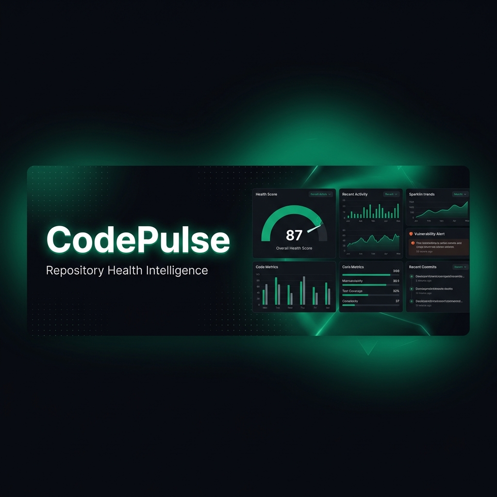
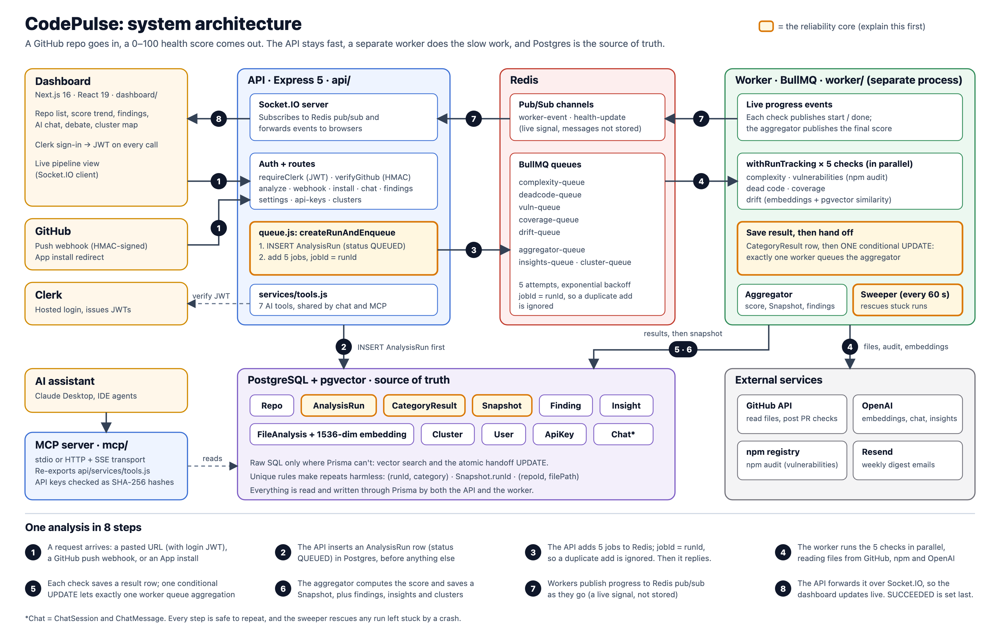
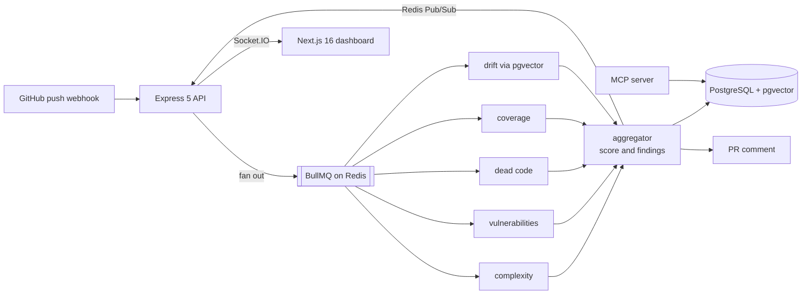

# CodePulse

**A GitHub App that scores your repo's health from 0 to 100 within 60 seconds of every push, then lets AI agents explain what to fix.**

[](https://github.com/HarshilModh/code_Pulse/actions/workflows/ci.yml)



## The problem

Code health problems like complex functions, vulnerable dependencies, dead code, missing tests and modules drifting from their design build up quietly and live in separate tools. CodePulse combines them into one score per push, posted where developers already look: the pull request.

## What it does

- Runs five analyses in parallel on every push and combines them into a weighted 0 to 100 health score.
- Detects architectural drift with OpenAI embeddings and pgvector cosine similarity, and groups related files with K-Means clustering.
- Four AI agents stream over SSE with OpenAI tool calling: repo chat, root cause investigation, a two persona design debate, and a guided codebase tour.
- An MCP server exposes the same repo health data to AI assistants in your IDE.
- Posts health breakdowns as PR comments and pushes live score updates to the dashboard over Redis Pub/Sub and Socket.IO.

## Architecture





| Signal | Weight | Engine |
|---|---|---|
| Complexity | 25% | escomplex |
| Vulnerabilities | 25% | npm audit |
| Coverage | 20% | CI artifacts |
| Dead code | 15% | ts-prune |
| Architectural drift | 15% | pgvector cosine similarity |

After scoring, the aggregator also runs semantic clustering and asks GPT for top risks and a recommended next action.

## MCP server

`mcp/` is a Model Context Protocol server with seven tools: `find_repo`, `search_code`, `get_metrics`, `get_snapshot_history`, `get_findings`, `read_file` and `get_diff`.

```bash
node mcp/server.js          # stdio, for local MCP clients
node mcp/server.js --http   # SSE on port 3002, authenticated with an X-Codepulse-Key API key
```

API keys are stored as SHA-256 hashes and managed from the dashboard.

## Tech stack

| Layer | Technology |
|---|---|
| Backend | Node.js, Express 5, Prisma (16 models), PostgreSQL + pgvector, BullMQ + Redis, Socket.IO |
| AI | OpenAI tool calling, text-embedding-3-small, ml-kmeans, Model Context Protocol SDK |
| Frontend | Next.js 16, React 19, TypeScript, Tailwind CSS 4, TanStack Query, Recharts + D3 |
| Platform | GitHub App (Octokit), Clerk auth, Stripe billing (Free, Pro, Team), Resend weekly digest |
| Testing | Vitest unit, integration and coordination tests for the worker pipeline, run in GitHub Actions |
| Infra | Docker Compose, Neon |

## Results

- Health score ready within 60 seconds of a push.
- Under 400 ms to the first streamed agent response.
- Drift lookups under 50 ms.

## Run it locally

Needs Node 18+, Docker, a GitHub App, an OpenAI key and a Clerk account. Run the API, worker and dashboard each in its own terminal.

```bash
git clone https://github.com/HarshilModh/code_Pulse.git && cd code_Pulse
docker compose up -d                       # PostgreSQL (pgvector) :5433, Redis :6379
cp .env.example api/.env && cp .env.example worker/.env
cd api && npm install && npx prisma generate && npx prisma db push && npm start
cd worker && npm install && npm start
cd dashboard && npm install && npm run dev   # http://localhost:3001
```

Run the tests with `cd worker && npm test` (needs the Docker Postgres and Redis running).

Environment variables, the full API reference, the project structure and the database schema are in [docs/setup.md](docs/setup.md).

## License

This project is for educational and portfolio purposes.
